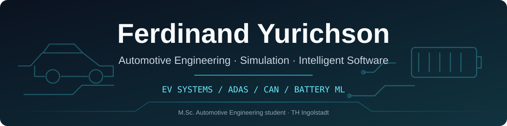

  

### Hi, I'm Ferdinand 👋

I'm a **Master's student in Automotive Engineering at Technische Hochschule Ingolstadt (THI)**, with a background in mechanical engineering and automotive production planning.

I build **engineering tools that connect physical models, vehicle data and software** — from EV/ADAS simulations and battery-health estimation to CAN telemetry, test automation and interactive applications. My interests are particularly in **vehicle dynamics, battery systems, verification, Python and applied machine learning**.

Based in Germany · Mechanical Engineering (B.Eng.) · Automotive Engineering (Master's student)

---

## Toolbox

**Programming & applications**  
     

**Simulation, data & AI**  
     

**Web, backend & development**  
       

**Engineering tools & areas**  
`CATIA V5` · `SolidWorks` · `Ultimaker Cura` · `Vehicle Dynamics` · `ACC/AEB` · `Battery SOH` · `CAN / DBC` · `Control Systems` · `Thermal Simulation` · `Test Automation`

---

## Featured automotive projects

<table>
  <tr>
    <td width="50%" valign="top">
       
      <b><a href="https://github.com/AsherFerdinand/VEUS-ev-testbench">VEUS — EV Simulation & ADAS Testbench</a></b> 
      Interactive vehicle physics and EV powertrain simulator with battery/regen modelling, cruise control, ACC, simplified AEB, live plots and scenario-based verification.  
      <code>Python</code> <code>Vehicle Physics</code> <code>ADAS</code> <code>Testing</code>
    </td>
    <td width="50%" valign="top">
       
      <b><a href="https://github.com/AsherFerdinand/ev-battery-health-ml">EV Battery Health Prediction & Anomaly Detection</a></b> 
      NASA battery-cycle analysis and SOH estimation using time-windowed features, cell-held-out validation, anomaly flags and a historical replay dashboard. Model limitations are documented.  
      <code>Python</code> <code>scikit-learn</code> <code>BMS / SOH</code> <code>ML Validation</code>
    </td>
  </tr>
  <tr>
    <td valign="top">
       
      <b><a href="https://github.com/AsherFerdinand/vcan-ecu-telemetry-dashboard">Virtual ECU & CAN Laboratory</a></b> 
      Modular ECU simulator and telemetry receiver with DBC decoding, transport-independent records, candump/CSV/JSON import and a Streamlit dashboard. CAN hardware integration is future work.  
      <code>Python</code> <code>cantools</code> <code>CAN / DBC</code> <code>Streamlit</code>
    </td>
    <td valign="top">
       
      <b><a href="https://github.com/AsherFerdinand/SimulinkMATLAB-dynamic-hydronic-balancing-simulation">Dynamic Hydronic Balancing — Bachelor's Thesis</a></b> 
      Simscape simulation of a 36-room apartment-building heating network, comparing uncontrolled, decentralised and centralised thermostat strategies for room temperature distribution.  
      <code>MATLAB</code> <code>Simulink / Simscape</code> <code>Control</code> <code>Thermal Systems</code>
    </td>
  </tr>
</table>

Engineering direction: connect simulated vehicle behaviour (VEUS), ECU/CAN telemetry and battery-health analytics into a common validation workflow. This is a roadmap, not a claim of completed integration.

## Software & engineering projects

<table>
  <tr>
    <td width="50%" valign="top">
       
      <b>ORBIT — Windows Dynamic Island</b> 
      Lightweight always-on-top Windows overlay with system monitoring, native volume controls, battery status and Brave media session integration. Built with Tauri, React and Rust.  
      <code>Tauri 2</code> <code>Rust</code> <code>React</code> <code>TypeScript</code>
    </td>
    <td width="50%" valign="top">
       
      <b><a href="https://github.com/AsherFerdinand/docker-fastapi-microservice-stack">Cloud Media & Auth Microservice Platform</a></b> 
      Containerised backend platform with JWT authentication, Nginx API gateway, PostgreSQL persistence and Redis caching.  
      <code>FastAPI</code> <code>Docker</code> <code>Nginx</code> <code>PostgreSQL</code> <code>Redis</code>
    </td>
  </tr>
  <tr>
    <td valign="top">
       
      <b><a href="https://github.com/AsherFerdinand/3d-printed-electric-locomotive">3D-Printed Electric Locomotive</a></b> 
      University group project; team lead with primary contributions to housing, chassis, coupling design and 3D-print slicing.  
      <code>CATIA V5</code> <code>Ultimaker Cura</code> <code>3D Printing</code> <code>Team Leadership</code>
    </td>
    <td valign="top">
      <b>More experiments</b> 
      Smaller exploratory projects in computer vision, solubility prediction, CFD surrogates and web development are available in my repositories.  
      <a href="https://github.com/AsherFerdinand?tab=repositories">Browse all repositories</a>
    </td>
  </tr>
</table>

---

  Interested in automotive simulation, vehicle software, test automation and applied AI. 
  <a href="https://github.com/AsherFerdinand?tab=repositories">Explore my repositories</a>

---

### 📫 Connect with Me
- **University:** Technische Hochschule Ingolstadt (THI)
- **LinkedIn:** [linkedin.com/in/ferdinandyurichson/](https://www.linkedin.com/in/ferdinandyurichson/)
