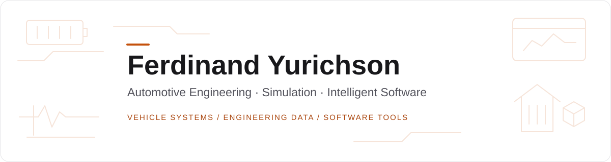

  

## Engineering through models, data and software

I'm **Ferdinand Yurichson**, a Master's student in **Automotive Engineering at Technische Hochschule Ingolstadt (THI)**, with a background in mechanical engineering. My work connects automotive systems, simulation and digital engineering with software tools and applied AI: EV and battery analytics, CAN telemetry, engineering dashboards and human–machine interfaces.

Several software-intensive projects below were architected and iteratively developed in collaboration with **OpenAI Codex**. I defined the engineering direction, feature priorities, validation goals and overall project scope.

## Toolbox

| Area | Tools & methods |
| --- | --- |
| Core software | Python · Rust · TypeScript / JavaScript · React · Tauri · Git / GitHub |
| Engineering & simulation | MATLAB · Simulink · Simscape · NumPy · Matplotlib · vehicle dynamics · control systems |
| Data & analytics | pandas · scikit-learn · chronological and held-out-cell evaluation · Streamlit |
| Automotive & systems | CAN · DBC · python-can · SocketCAN · EV telemetry · scenario-based verification |
| Platforms & interfaces | FastAPI · Docker · PostgreSQL · Redis · Nginx · native Windows APIs |
| Mechanical & design | CATIA V5 · SolidWorks · Ultimaker Cura · additive manufacturing |

## Automotive Systems & EV Data

<table>
  <tr>
    <td width="50%" valign="top">
       
      <b><a href="https://github.com/AsherFerdinand/VEUS-ev-testbench">VEUS — EV Engineering Testbench</a></b>  
      Interactive longitudinal EV simulation, simplified ACC/AEB and scenario-based verification. Recorded-EV replay and investigation are documented on the development branch; physical model validation remains inconclusive.  
      Python · FastAPI · NumPy · ADAS
    </td>
    <td width="50%" valign="top">
       
      <b><a href="https://github.com/AsherFerdinand/ev-battery-health-ml">EV Battery Health ML</a></b>  
      NASA battery-ageing study with windowed SOH estimation, degradation forecasting and historical replay. Chronological and held-out-cell evaluation expose generalisation limits; this is exploratory laboratory research.  
      Python · scikit-learn · pandas · HTML dashboard
    </td>
  </tr>
</table>

<table>
  <tr>
    <td width="50%" valign="top">
       
      <b><a href="https://github.com/AsherFerdinand/vcan-ecu-telemetry-dashboard">VCAN — CAN Engineering Studio</a></b>  
      Inspect classical CAN frames, DBC decoding, virtual ECU communication and bitwise arbitration. Recorded-data workflows retain provenance and quality checks; hardware and independent physical validation remain outstanding.  
      Python · python-can · cantools · Streamlit
    </td>
    <td width="50%" valign="top">
       
      <b><a href="https://github.com/AsherFerdinand/VECTOR">VECTOR — Vehicle Simulation Foundation</a></b>  
      Browser-based 3D vehicle laboratory with a deterministic kinematic bicycle model, manual driving and live telemetry. The v0.1 foundation excludes autonomous navigation, sensors and collision response.  
      TypeScript · React · Three.js · Vitest
    </td>
  </tr>
</table>

## Simulation & Digital Engineering

<table>
  <tr>
    <td width="50%" valign="top">
       
      <b><a href="https://github.com/AsherFerdinand/SimulinkMATLAB-dynamic-hydronic-balancing-simulation">Hydronic Heating — Bachelor’s Thesis</a></b>  
      MATLAB/Simulink study of a 36-room building and its hydronic heating network. Compares uncontrolled, local-thermostat and coordinated supervisory-control strategies for room warm-up.  
      MATLAB · Simulink · Simscape · thermal control
    </td>
    <td width="50%" valign="top">
       
      <b><a href="https://github.com/AsherFerdinand/THERMA">THERMA — Thermal Systems Research</a></b>  
      Hydronic-heating digital-twin research with a completed static reference inventory, migration/data plans and MATLAB diagnostic tooling. MATLAB execution and reference validation remain pending; the physics solver and web application are planned.  
      Python · reference analysis · model migration
    </td>
  </tr>
</table>

###  [VIBRA — Structural Dynamics & FEM Workbench](https://github.com/AsherFerdinand/VIBRA/tree/feat/interactive-cae-stress-workbench)

Python workbench for small planar structural models: static, modal, harmonic and transient FEM analysis, beam stress, signal diagnostics and idealised motor-mount studies. The linked development branch includes an interactive Streamlit/Plotly interface and analytical verification; experimental validation remains outstanding.

Python · NumPy · SciPy · Streamlit · Plotly

## Software Platforms & Interfaces

<table>
  <tr>
    <td width="50%" valign="top">
       
      <b><a href="https://github.com/AsherFerdinand/orbit-desktop">ORBIT — Windows Desktop Companion</a></b>  
      Compact desktop interface with native media controls, system telemetry, local Quick Notes and reminders. Rust/Tauri integrates Windows APIs with a React interface; a public v0.5.0 release is available.  
      Rust · Tauri 2 · React · TypeScript
    </td>
    <td width="50%" valign="top">
       
      <b><a href="https://github.com/AsherFerdinand/docker-fastapi-microservice-stack">Cloud Media & Auth Platform</a></b>  
      Containerised demonstration of JWT authentication, image uploads, persistent metadata and caching behind an API gateway. Includes an interactive web dashboard; cloud deployment and advanced file workflows remain roadmap items.  
      FastAPI · Docker · PostgreSQL · Redis · Nginx
    </td>
  </tr>
</table>

## Mechanical Design & Prototyping

### [3D-Printed Electric Locomotive](https://github.com/AsherFerdinand/3d-printed-electric-locomotive)

University team project taking a locomotive from CAD to physical prototype. As team lead, I coordinated development and contributed primarily to the housing, chassis, coupling design and print preparation; other team members developed additional subsystems.

CATIA V5 · Ultimaker Cura · mechanical design · additive manufacturing

---

[Explore all repositories](https://github.com/AsherFerdinand?tab=repositories) · [LinkedIn](https://www.linkedin.com/in/ferdinandyurichson/)
